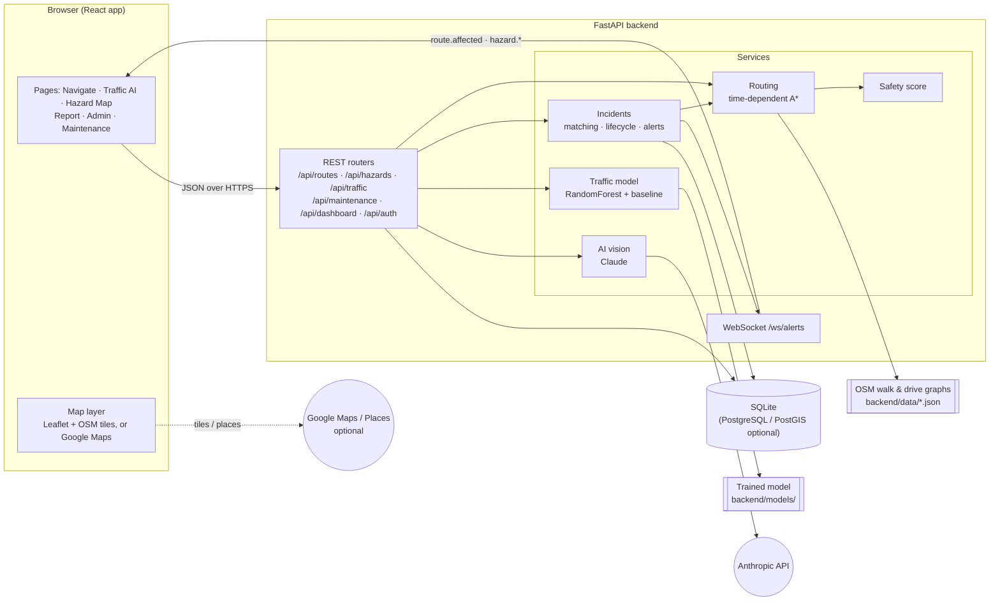

# SafeRoute AI

**Predict Traffic. Detect Hazards. Navigate Smarter.**

Hazard-aware walking and driving navigation for Cyberjaya, powered by community reports, live alerts and traffic forecasting.

| | |
|---|---|
| **Challenge** | Cyberjaya 5G Future Talent Innovation Challenge 2026 · Track 2: Connected & Safe Mobility |
| **Team** | CrocodileTeam |
| **Deployed app** | _not deployed yet (runs locally, see [Setup](#setup-and-run-locally))_ |
| **Demo videos** | _to be added (1-minute tour and full walkthrough)_ |
| **Pitch deck** | _to be added_ |

> **Demo data notice.** Roads, footpaths and places are real OpenStreetMap data. The seeded hazards and all
> traffic observations and forecasts are **synthetic** and are labelled as such everywhere in the app. No live
> traffic feed is connected.

---

## Problem statement

Students, staff and drivers in Cyberjaya move between campuses, offices and malls every day, on foot and by car.
The routes they rely on change in ways that today's map apps don't capture:

- **Hazards go unreported.** Fallen trees, flooding, potholes and broken walkways are seen by many people but
  reach nobody who could warn others or fix them.
- **No warning on the way.** Someone who has already set off has no idea a path ahead has just been blocked.
- **"Fastest" isn't always safe.** Navigation ranks routes by time only; poorly lit or hazard-prone paths are
  never weighed against a slightly longer, safer one.
- **Congestion is a surprise.** Drivers can't see how the next few hours will develop or when it's best to leave.
- **Slow, untracked follow-up.** When a hazard is reported, there's no shared record of who verified it, who is
  fixing it and when the path is safe to use again.

## Our solution

SafeRoute AI is a navigation and incident-management app for a Cyberjaya pilot area. It plans routes on the real
footpath and road network, keeps them away from reported hazards, alerts people already on the move, and forecasts
traffic. Every AI suggestion is explained, and **only a human operator can confirm a closure**.

It has four role-based views:

**Student / pedestrian**
- **Smart Navigation**: three route options (Fastest, Safest and an AI-recommended Smart Balance), each with time,
  distance, an explainable safety score and the hazards on it.
- **Live alerts and rerouting**: if a hazard is reported on your route while you're navigating, you get an alert
  within about a second, with your route compared side by side against a hazard-free alternative.
- **Report a hazard**: photo, category, severity and a pin that is matched to the exact mapped path. AI photo
  analysis suggests a category when it is configured.
- **Community Hazard Map**, **My Reports** and **Notifications** to follow what happens next.

**Driver**
- Everything above in drive mode, with time-dependent routing on the road network.
- **Traffic AI**: congestion heatmap and hotspots, journey time by departure (usual vs fastest route), time
  savings, and **best time to leave** for an arrival deadline.

**Safety operator**
- Live verification queue: verify, reject or merge duplicates, correct locations, set severity and restriction.
- **Confirm closures**: routing then excludes the path until the operator explicitly reopens it.
- Assign maintenance, accept clearance, resolve and reopen. Every action is written to an audit trail.
- Analytics and the navigation sessions affected by each hazard.

**Maintenance crew**
- Assigned tasks with the affected path on a map, directions to the site, start work, completion photo and notes,
  then request clearance. The crew cannot reopen a path themselves.

## How it works

- **Routing**: walking and driving use separate graphs built from OpenStreetMap. The search is a time-dependent
  A* whose cost combines travel time with risk. Fastest ignores risk, Safest weighs it heavily, and Smart Balance
  sits in between. Lines on the map always follow real edges; the short walk from your exact pin to the nearest
  path is drawn dashed.
- **Safety score**: `100 × (1 − weighted risk)`, with weights active hazards 35%, past incidents 25%, lighting
  15%, weather 15% and path condition 10%. Missing lighting or surface data counts as uncertainty, not as safe.
  It is a heuristic, not an accident probability.
- **Hazard → path matching**: a report is linked to path segments within 12 m (reliable) or 25 m (approximate).
  Unverified reports add a warning, verified hazards a caution, and confirmed closures remove the segment from
  routing. Duplicates within 40 m and 48 h are merged.
- **Targeted live alerts**: when a hazard affects segments that an active navigation session uses, the backend
  computes an alternative and pushes it over a WebSocket to that user only, with duplicate suppression.
- **Traffic forecasting**: a RandomForest model predicts corridor speeds 15, 30 and 60 minutes ahead (also 2 h and
  4 h). Inputs are the corridor and road class, time of day, day of week, the current speed, the historical-average
  baseline, and weather and incidents at the target time. Uncertainty comes from the spread across trees. On a
  held-out week it beats the historical-average baseline (speed MAE 1.85 vs 2.21 km/h). Drive routes use the
  forecast speed at the moment you reach each road.
- **AI photo analysis**: Claude (`claude-opus-5-5`, server-side) returns a strict JSON classification that the
  server validates. Without an API key, or if a call fails, the app says so and the reporter classifies
  manually. AI never closes a path.

## Architecture



### Layers

| Layer | What it does | Where |
|---|---|---|
| **Frontend** | Role-based pages, live alert handling (WebSocket with reconnect), map rendering through engine-neutral primitives that work on both Leaflet and Google Maps | `frontend/src/pages`, `context/`, `components/map/` |
| **API** | REST endpoints with server-side role checks on every route, JWT auth, rate-limited reporting, image upload (re-encoded, EXIF/GPS stripped) | `backend/app/routers/`, `security.py` |
| **Routing engine** | OSM network loading and spatial index, time-dependent A*, route description and explanation | `services/graph.py`, `routing.py`, `planner.py` |
| **Safety** | Explainable per-route safety score and factor breakdown | `services/safety.py` |
| **Incidents** | Path matching, duplicate detection, lifecycle transitions, audit history, targeted alerts and rerouting | `services/incidents.py`, `realtime.py` |
| **Traffic AI** | Synthetic traffic generator, model training and evaluation, forecaster, best-departure search | `services/traffic_sim.py`, `traffic_model.py`, `routers/traffic.py` |
| **AI vision** | Claude photo classification with schema validation and fallbacks | `services/ai_vision.py` |
| **Data** | SQLAlchemy models (users, incidents, reports, impacts, sessions, tasks, notifications, history, traffic) | `backend/app/models.py` |

### Key flows

1. **Plan a route**: `POST /api/routes/compare` builds the hazard index and traffic context, runs A* three times
   (fastest / safest / balanced), scores each route and returns geometry, safety factors and an explanation.
2. **Report → alert → reroute**: `POST /api/hazards` matches the pin to path segments and creates or merges the
   incident. It then finds active sessions that use those segments, computes an alternative and pushes
   `route.affected` to each affected user over the WebSocket.
3. **Verify → fix → reopen**: operator verify (optionally closing the path) → assign → maintenance starts work
   and requests clearance → operator resolves (the closure stays) → operator reopens the path. Each step is logged.
4. **Traffic forecast**: `POST /api/traffic/predict` returns route options at the chosen departure, a 3-hour
   timeline of usual vs fastest journey times, and insights generated only from those numbers.

## Tech stack

| Layer | Tools |
|---|---|
| Frontend | React 18, TypeScript, Vite, Tailwind CSS, React Router, Recharts, Leaflet / React-Leaflet, Google Maps JS API (optional), lucide-react |
| Backend | Python, FastAPI, SQLAlchemy 2, Pydantic, WebSockets, PyJWT |
| Routing & data | OpenStreetMap (Overpass extract), NetworkX for graph building, custom time-dependent A* |
| Machine learning | scikit-learn (RandomForest), NumPy, pandas |
| AI | Anthropic Claude (vision, structured JSON output) |
| Database | SQLite (default); PostgreSQL / PostGIS supported via `DATABASE_URL` |
| Testing | pytest (API and engine tests), Playwright (browser end-to-end checks) |
| Deployment | Docker; Render Blueprint (`render.yaml`, single service); docker-compose for PostgreSQL / PostGIS |

## Project structure

```
CrocodileTeam/
├── backend/
│   ├── app/
│   │   ├── main.py            # FastAPI app, routers, WebSocket endpoint, startup
│   │   ├── config.py          # settings from backend/.env
│   │   ├── models.py          # database tables
│   │   ├── security.py        # auth, roles, rate limiting
│   │   ├── seed.py            # demo users, synthetic hazards and traffic, model training
│   │   ├── routers/           # auth, routes, hazards, traffic, maintenance, dashboard, admin, places, notifications
│   │   └── services/          # graph, routing, planner, safety, incidents, realtime, traffic_sim, traffic_model, ai_vision
│   ├── data/                  # OSM walk/drive graphs, places, traffic corridors (+ raw OSM extract)
│   ├── scripts/build_graph.py # rebuilds the graphs from the raw OSM extract
│   ├── migrations/            # PostGIS spatial columns and indexes
│   └── tests/                 # pytest suite
├── frontend/
│   └── src/
│       ├── pages/             # Overview, Navigate, TrafficForecast, HazardMap, ReportHazard, admin/, maintenance/ …
│       ├── components/        # route cards, hazard panels, layout, map/ (Leaflet + Google engines)
│       ├── context/           # auth, real-time alerts, navigation state
│       └── lib/               # API client, types, formatting
├── Dockerfile                 # single image: builds the frontend, serves it with the API
├── render.yaml                # Render Blueprint (one web service + persistent disk)
└── docker-compose.yml         # alternative: PostGIS + API + web
```

## Setup and run locally

### Prerequisites

- Python 3.11+
- Node.js 20+ and npm
- _(Optional)_ an Anthropic API key for AI photo analysis
- _(Optional)_ a Google Maps browser key for the Google base map and place search

### 1. Clone the repository

```bash
git clone https://github.com/Jeesyuen/CrocodileTeam.git
cd CrocodileTeam
```

### 2. Backend

```bash
cd backend
python -m venv .venv

# Windows (PowerShell)
.venv\Scripts\Activate.ps1
# macOS / Linux
source .venv/bin/activate

pip install -r requirements.txt
cp .env.example .env              # optional: add API keys, see Configuration
python -m app.seed                # creates saferoute.db, seeds demo data, trains the traffic model (~30 s)
uvicorn app.main:app --port 8000
```

The API runs at http://localhost:8000, with interactive docs at http://localhost:8000/docs.

### 3. Frontend

In a second terminal:

```bash
cd frontend
npm install
npm run dev
```

Open http://localhost:5173 and pick a demo account on the login page. The dev server forwards `/api`, `/uploads`
and `/ws` to the backend on port 8000.

### 4. Run the tests (optional)

```bash
cd backend
python -m pytest -q        # API and engine tests
cd ../frontend
npm run build              # type-check and production build
```

## Configuration

| Setting | Where |
|---|---|
| AI photo analysis | `backend/.env` → `ANTHROPIC_API_KEY` (server-side only), `VISION_MODEL` |
| Google Maps base map + place search | `backend/.env` → `GOOGLE_MAPS_BROWSER_KEY`, `GOOGLE_MAPS_MAP_ID` |
| Database | `backend/.env` → `DATABASE_URL` (SQLite by default) |
| JWT signing secret | `backend/.env` → `JWT_SECRET` (use a long random value in production) |
| Allowed frontend origins (CORS) | `backend/.env` → `CORS_ORIGINS` |
| Demo mode (demo accounts, reset button) | `backend/.env` → `DEMO_MODE` |
| Backend URL for a separately hosted frontend | `frontend/.env` → `VITE_API_URL` |
| OSM tile server for the fallback map | `frontend/.env` → `VITE_MAP_TILE_URL`, `VITE_MAP_TILE_ATTRIBUTION` |

**Google Maps key:** the browser key is sent to signed-in users, so it is public by design. Restrict it in Google
Cloud to your site's HTTP referrers and to *Maps JavaScript API* and *Places API (New)*. Without a key, or if
Google rejects it, the app falls back to a clearly labelled OpenStreetMap map. Google provides only the base map
and place search; routes, travel times and traffic always come from SafeRoute's own engine.

## Deploy on Render

The repository includes a Render Blueprint. It deploys **one web service** built from the root `Dockerfile`:
the React app, the API and the live-alert WebSocket share one URL, so no CORS or frontend API URL is needed.

1. Push the repository to GitHub.
2. In the Render dashboard: **New → Blueprint**, connect the repository and select `render.yaml`.
3. When prompted, enter `ANTHROPIC_API_KEY` (and optionally the Google Maps values). `JWT_SECRET` is generated
   automatically.
4. Click **Apply**. The first build takes a few minutes. On first start the container seeds the demo data and
   trains the traffic model (seeding runs only when the database is empty, so restarts keep real reports).
5. Open the service URL (`https://<service-name>.onrender.com`) and check `/api/health` shows `"ai_configured": true`.

**Plan:** `render.yaml` uses the Starter plan with a 1 GB disk (`/var/data`) so the database, photos and model
survive restarts and the app never sleeps. To use the free plan, set `plan: free` and remove the `disk:` block.
It still works, but it sleeps after 15 minutes idle (the next visit takes about a minute) and resets to the demo
data on every restart.

**Before sharing the link:** set a monthly spending limit in the Anthropic console. Demo accounts are one-click,
so anyone with the URL can trigger AI photo analysis.

## Demo data

- **Accounts.** 20 demo users, all with password `demo1234` and one-click sign-in on the login page:

  | Role | Email |
  |---|---|
  | Student A (reports hazards) | student.a@demo.saferoute.my |
  | Student B (navigates, receives alerts) | student.b@demo.saferoute.my |
  | Driver | driver@demo.saferoute.my |
  | Safety operator | operator@demo.saferoute.my |
  | Maintenance | maintenance@demo.saferoute.my |

- **Hazards.** 34 synthetic hazards placed on real mapped paths, at different lifecycle stages.
- **Traffic.** A reproducible synthetic history for 27 named corridors (rush hours, rain and incidents), used to
  train and evaluate the model. Results on synthetic data say nothing about real-world accuracy.
- **Reset.** Admin Dashboard → **Reset demo data** (operators, demo mode only) restores the original state.

### Demo scripts

**Demo A: fallen tree (live alert → closure → fix).** Use two browser windows, one of them private.
1. Window 1, **Student B**: Smart Navigation → *Try a demo trip* → **Start navigation**.
2. Window 2, **Student A**: Report Hazard → photo → *Fallen Tree*, High, Fully blocked → pin on B's route → Submit.
3. Window 1 shows *Hazard reported on your route* with a comparison → **Use alternative route**.
4. **Operator**: Hazard Management → Verify → *Confirm closure*. Routes now avoid that path.
5. Operator → **Assign maintenance**. **Maintenance**: Start work → notes → request clearance.
6. Operator: **Accept & resolve** (the path stays closed) → **Reopen path**.

**Demo B: congestion (Traffic AI).** Sign in as **Driver** → Traffic AI. Pick a departure slot or a custom
peak time (e.g. 17:30) to see the heatmap, hotspots and recommendation update. Then use **Best time to leave**
with an arrive-by time, and **Open route in navigation**.

## Known limitations

- Traffic data is synthetic; there is no live traffic feed.
- AI photo analysis needs an Anthropic API key; without one it falls back to manual classification.
- Google Maps mode was checked only in Google's keyless development mode; Places search needs a real key.
- Cycling and motorcycle routing are not implemented yet.
- The Docker image was not built locally (no Docker daemon); its start-up command and single-service serving were
  tested with the same settings outside Docker. The PostgreSQL path is untested (SQLite was used). The schema is
  created from the SQLAlchemy models; there are no versioned migrations.
- Uploaded photos are served to anyone with the URL, and report rate limiting is in-memory.

## Team

**CrocodileTeam**

- Chew Jee Syuen
- Cheah Jie Xuan
- Priscilia Lim Jyi Rou

Map and place data © OpenStreetMap contributors, available under the ODbL.
